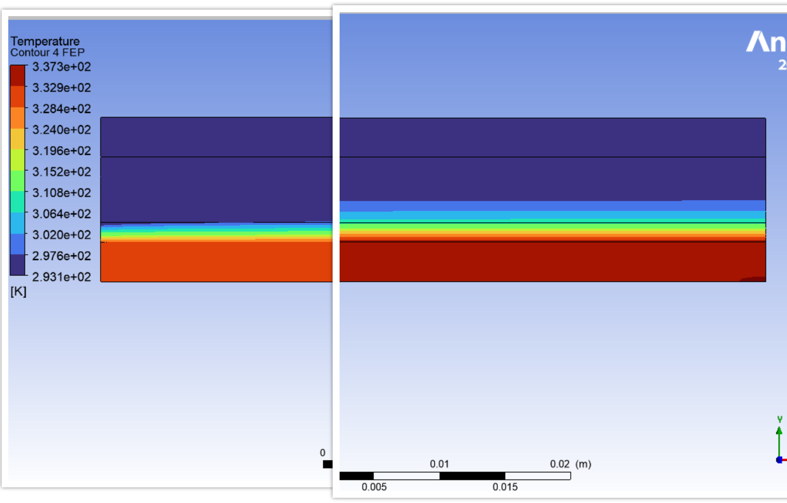
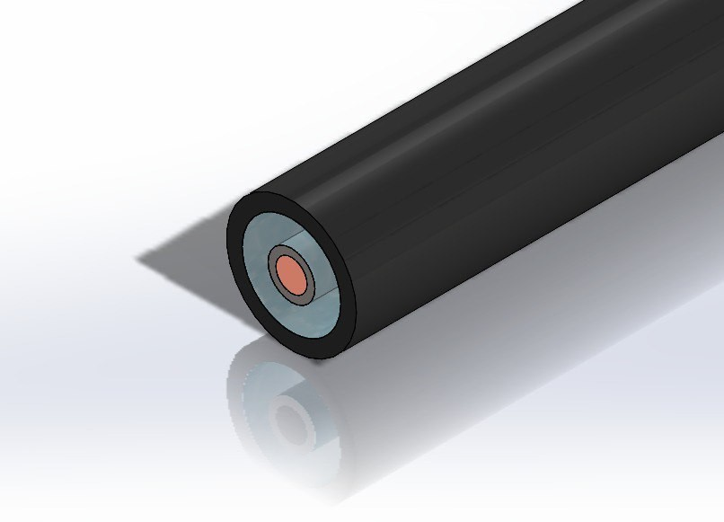
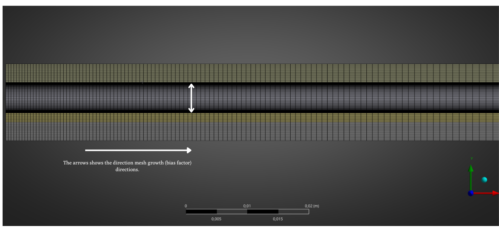
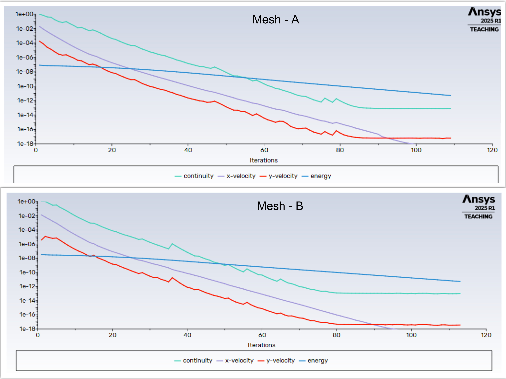
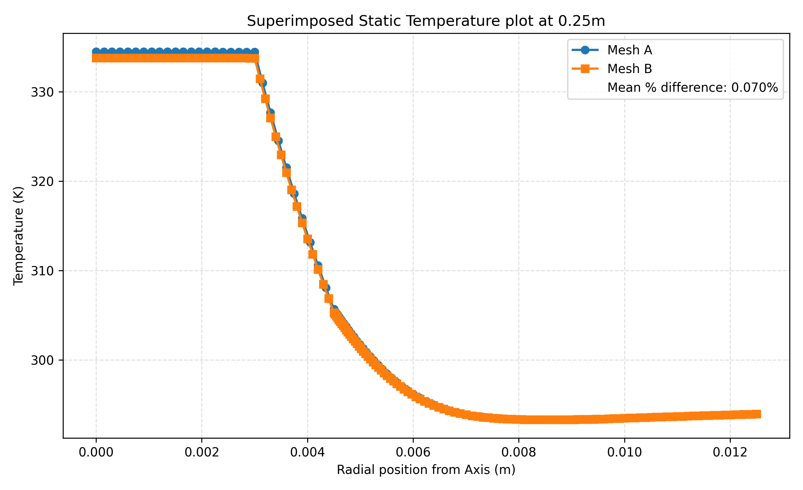
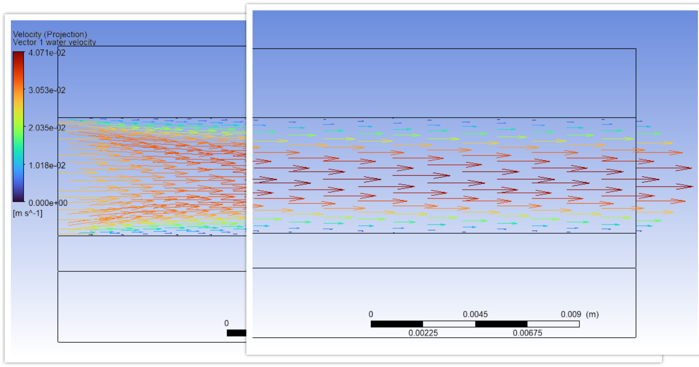
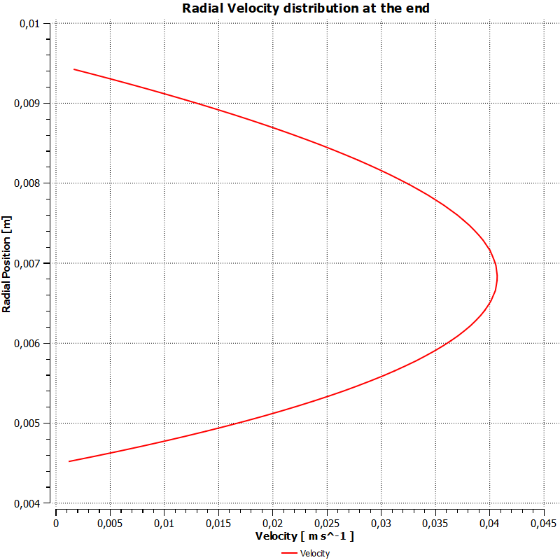
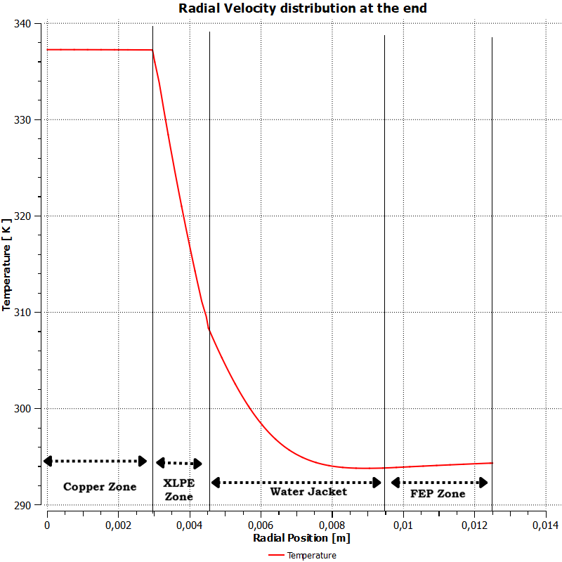

# 2D-Axisymmetric CFD of an Actively Cooled EV Charging Cable

Thermo-fluidic characterization of a liquid-cooled electric vehicle fast-charging cable carrying
**500 A DC**. A conjugate heat transfer (CHT) model in **Ansys Fluent** couples Joule heating in the
copper conductor with laminar water flow in an annular cooling jacket, to verify that the cooling keeps
the XLPE insulation within its thermal limit.

Course project for **Laboratory of Computational Thermo-Fluid Dynamics**, University of Padova
(instructor: Prof. Stefano Bortolin), March 2026.

📄 **Full report:** [`report/EV-Charging-Cable-CFD-Report.pdf`](report/EV-Charging-Cable-CFD-Report.pdf)



## Key results

| Quantity | Result |
|---|---|
| Joule heating in the conductor | q‴ = 5.25 × 10⁶ W/m³ → **74.25 W** over the 0.5 m cable |
| Coolant temperature rise | **ΔT = 3.38 °C** (20.0 → 23.38 °C), meeting the > 3 °C design requirement |
| Peak conductor temperature | ≈ 64 °C (337 K), well below the 90 °C limit of the XLPE insulation |
| Water-side heat transfer coefficient at the exit | **α<sub>w</sub> = 346.7 W/(m²·K)** |
| Local Nusselt number | **Nu ≈ 5.8**, matching the fully developed laminar annulus benchmark (5.4–5.8) |
| Flow regime | Laminar, fully developed parabolic profile (inlet 0.027 m/s, Re ≈ 270) |
| Grid independence | Doubling the mesh changes T<sub>max</sub> by 0.003 % and T<sub>out</sub> by 0.0004 % |

## Model

**Geometry (2D-axisymmetric, 0.5 m long)**

| Layer | Material | Radial extent |
|---|---|---|
| Conductor | Copper, Ø 6 mm | 0 – 3.0 mm |
| Insulation | XLPE, 1.5 mm | 3.0 – 4.5 mm |
| Cooling jacket | Water annulus, 5 mm gap | 4.5 – 9.5 mm |
| Outer sheath | FEP, 3 mm | 9.5 – 12.5 mm |



**Physics and boundary conditions**
- Steady, incompressible, laminar flow; constant properties; CHT between all solid and fluid zones.
- Copper: uniform volumetric heat source from Joule heating, q‴ = I²ρₑ/A².
- Water inlet: uniform velocity, 20 °C. Outlet: pressure outlet, 0 Pa gauge.
- Outer FEP surface: convection to 25 °C ambient air, h ≈ 10 W/(m²·K).
- Axis of symmetry at r = 0.

**Velocity envelope**: the inlet velocity was chosen between the boiling limit (0.001 m/s), the laminar limit
(0.231 m/s, Re = 2300) and the design limit for a ≥ 3 °C temperature rise (0.027 m/s).

**Numerics**: pressure-based steady solver, SIMPLE coupling, second-order upwind for momentum and energy,
scaled residuals below 10⁻¹⁰; structured mesh with bias towards the walls of the water jacket.

| Mesh with near-wall refinement | Convergence history (Mesh A and B) |
|---|---|
|  |  |

## Verification

Two meshes were compared: **Mesh A** (43,450 elements) and **Mesh B** (98,010 elements).
Mass and energy balances close for both (net energy imbalance < 0.04 W out of 74.25 W), and the radial
temperature profiles at mid-length overlap, so Mesh A was used for the results.



## Results

| Velocity vectors in the water jacket | |
|---|---|
|  | The uniform inlet profile develops into a parabolic laminar profile, with no separation or mixing. |

| Velocity profile near the exit | Temperature profile near the exit |
|---|---|
|  |  |

- **Copper** is almost isothermal thanks to its high conductivity.
- **XLPE** carries the steepest temperature drop: it is the main thermal resistance.
- **Water** absorbs the heat through a thermal boundary layer that thickens along the cable.
- **FEP** shows a small further drop; its outer surface stays slightly above ambient.

The local heat transfer coefficient was extracted on a 5 mm segment of the XLPE–water wall at the outlet:
α<sub>w</sub> = q″ / (T<sub>wall</sub> − T<sub>bulk</sub>) = 4599.7 / (309.80 − 296.53) ≈ 346.7 W/(m²·K).

## Repository structure

```
├── report/
│   └── EV-Charging-Cable-CFD-Report.pdf     full report (34 pages)
├── figures/                                  figures extracted from the report
└── README.md
```

## References

1. S. Bortolin, *Computational Thermo-Fluid Dynamics Lab*, lecture notes, University of Padova.
2. S. V. Patankar, *Numerical Heat Transfer and Fluid Flow*, Hemisphere, 1980.
3. ANSYS, Inc., *Ansys Fluent Theory Guide*, Release 2025 R1.
4. Y. Li, X. Zhang, J. Wang, "Study on temperature rise characteristics of DC charging cable for electric vehicles", *Numerical Heat Transfer, Part A*, doi: 10.1080/10407782.2023.2285374.

## Author

**Kaleb Kassa Lafebo**, M.Sc. Energy Engineering, University of Padova.
[LinkedIn](https://www.linkedin.com/in/kaleb-kassa) · [GitHub](https://github.com/Kaleb-kass)
